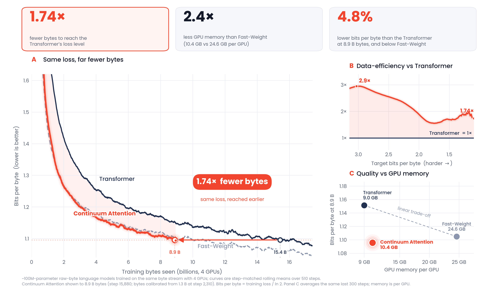

# Continuum Attention

[](https://arxiv.org/abs/2610.20586)

<p align="center">
  
</p>

**Continuum Attention (CA)** is causal attention over continuous, piecewise-linear key/value trajectories, using closed-form exponential moments and analytical first-order gradients.

This repository provides two implementations:

- **Apple Silicon / Metal:** the approximately 5M-parameter TinyStories experiments and five-seed comparisons reported in the paper.
- **NVIDIA CUDA v6:** a separate 101,205,120-parameter CA-S decoder with full-context CUDA numerical/causality tests, single-GPU training and single-node Slurm launchers. See [CUDA documentation](cuda/README.md).

The CUDA code uses learned per-head gains initialized at effective temperature $\tau=1$. The paper's strongest small-model CA-P variant instead uses a fixed $\tau=0.30$.

## How it works

For a causal query $q_i$, with endpoint scores $s_{ij} = q_i^\top k_j/(\tau\sqrt{d_h})$, each adjacent pair of keys and values defines a continuous memory segment:

$$
\begin{aligned}
k_j(u) &= (1-u) k_{j-1}+u k_j,\\
v_j(u) &= (1-u) v_{j-1}+u v_j, \qquad 0\le u\le1.
\end{aligned}
$$

Writing $a=s_{i,j-1}$ and $\Delta=s_{ij}-s_{i,j-1}$, define

$$J_n(\Delta)=\int_0^1 u^n e^{\Delta u}\,du.$$

The exact exponential mass and value numerator for the segment are

$$
M=e^a J_0(\Delta),\qquad
U=e^a\big[(J_0-J_1)v_{j-1}+J_1v_j\big].
$$

CA sums these terms over the visible prefix and adds the **half token caps** at the first and last visible positions, then divides the accumulated numerator by the accumulated mass. Its segmentwise mean interpolation coordinate is $\mu=J_1/J_0$. The backward kernel uses moments through $J_2$. The stable implementations apply score shifting and Taylor expansions around $\Delta=0$.

CA can be computed as **CA weights multiplied by the original value matrix**. These weights remain causal, nonnegative, and row normalized. The fixed gain variant **P** uses $\tau=0.30$ and has the *same parameter count* as fixed gain softmax **B**. The learned gain variant **H** initializes each attention head at the same effective temperature.

## NVIDIA CUDA v6 — single GPU or Slurm

All CUDA files are placed directly in [`cuda/`](cuda/), with a self-contained model, data loader, distributed utilities, benchmark and launchers.

```text
cuda/
├── continuum_attention.py
├── data.py
├── runtime.py
├── benchmark.py
├── test_cpu.py
├── run.sh
├── train.sbatch
├── benchmark.sbatch
├── requirements.txt
├── example.txt
└── README.md
```

Install CUDA-enabled PyTorch and the CUDA dependencies:

```bash
python -m pip install -r cuda/requirements.txt
python cuda/test_cpu.py
bash cuda/run.sh check
bash cuda/run.sh benchmark
```

Train on a single NVIDIA GPU:

```bash
DATASET_NAME=HuggingFaceFW/fineweb-edu DATASET_CONFIG=sample-10BT \
  BATCH_SIZE=1 OUTPUT_DIR=runs/ca_cuda bash cuda/run.sh train
```

Or on a Slurm cluster (one GPU or four GPUs on one node):

```bash
sbatch --partition=YOUR_GPU_PARTITION --gres=gpu:1 cuda/train.sbatch
sbatch --partition=YOUR_GPU_PARTITION --gres=gpu:4 cuda/train.sbatch
```

The Slurm templates take account, partition, QoS, software environment and GPU allocations from each site's configuration. See [CUDA setup, benchmark, and training options](cuda/README.md).

### V100 operator benchmark

At `[B,H,T,D]=[2,16,2048,64]`, query tile 128:

| CUDA implementation | Forward | Backward | Total |
| --- | ---: | ---: | ---: |
| v5 | 5.974 ms | 13.543 ms | 19.519 ms |
| **v6** | **5.012 ms** | **11.587 ms** | **16.603 ms** |

V6 achieved **1.176× faster isolated CA attention forward/backward** than v5 on a Tesla V100. The operator and full decoder passed tested future-token causality checks at 2,048 tokens. This is not a measurement of overall training throughput or a new quality result for the 100M model.

## Files

| Path | Purpose |
| --- | --- |
| [`cuda/`](cuda/) | NVIDIA CUDA v6 model, kernels, byte loader, Slurm templates, benchmarks, and CPU regression tests. |
| `acma_metal.py` | **Canonical runtime Metal source** embedded as `METAL_SOURCE` and its PyTorch autograd wrappers. |
| `metal/continuum_attention.metal` | Identical extracted Metal Shading Language source for syntax highlighting and code review. **Do not compile it separately for this Python implementation.** |
| `architecture.py` | Exact PyTorch attention weights, Transformer architecture, and B/F/G/S/H/P variants. |
| `analytic_reference.py` | Independent CPU friendly analytical gradient oracle using $J_0,J_1,J_2$. |
| `verify_backward_mps.py`, `verify_long_mps.py`, `verify_mps.py` | GPU versus independent CPU float64 reference checks. |
| `test_*.py` | CPU numerical correctness, causal masking, gradient, model, and protocol tests. |
| `benchmark.py` | Training, evaluation, checkpoints and throughput. |
| `paper_experiment.py` | Multi seed study runner, including `--only-hp`. |
| `summarize_paper.py`, `summarize_hp.py` | Development evaluation and paired seed statistics. |
| `final_holdout.py`, `evaluate_hp_holdout.py` | Holdout evaluation scripts. The H/P one is explicitly exploratory. |
| `examples/quickstart.py` | No download forward and backward demonstration on CPU or MPS. |
| `docs/` | Historical original experiment protocol and H/P protocol. |

## Apple Silicon / Metal requirements

- macOS on an Apple Silicon Mac for **Metal** kernels.
- Python 3.10 or later and PyTorch with `torch.mps.compile_shader` (the study used **PyTorch 2.8.0**).
- `numpy`, `datasets` for the TinyStories stream, and `scipy` for statistical analysis. See `requirements.txt`.
- CPU mode works without macOS or MPS, for the reference implementation and CPU tests.
- Metal kernels require **float32 scores**, and `metal_direct` is a diagnostic backend. All other shipped models use float32.

```bash
python -m pip install -r requirements.txt
```

The required PyTorch build and MPS support depend on your operating system. Install the appropriate official PyTorch distribution for your Mac.

## Quick start: no data download

```bash
# CPU reference
python examples/quickstart.py --device cpu --seq-len 192

# Apple MPS: exact analytical Metal backward
python examples/quickstart.py --device mps --seq-len 192
python examples/quickstart.py --device mps --seq-len 512
```

Run the independent CPU regression tests:

```bash
python -m unittest -v \
  test_acma.py test_fusion.py test_analytic_backward.py \
  test_long.py test_paper_protocol.py test_hp_only.py
python tools/verify_shader_sync.py
```

On your Mac, additionally verify the Metal gradients against the float64 CPU oracle **at the sequence length you plan to train**:

```bash
python verify_backward_mps.py --backend metal_analytic --lengths 192
python verify_long_mps.py --lengths 512
```

## Metal backends

| Backend | Role | Supported sequence length |
| --- | --- | --- |
| `reference` | Vectorized exact PyTorch weights and autograd | Test/prototype use; memory bound at long lengths |
| `metal_analytic` | Per query Metal weight kernel and fused analytical score backward | Up to 256 |
| `metal_long` | Tiled score handling and elementwise Metal coefficients / gradients | Up to 1024; used for 512 |
| `metal_direct` | Diagnostic direct integration of values, without materializing the CA probability matrix | Up to 256; **backward recomputes reference autograd**, so not the measured main configuration |

The `metal_analytic` and `metal_long` paths **materialize the dense attention score/weight arrays**, so their attention storage is $O(T^2)$. They have $O(T^2d_h)$ computation per head and are **not FlashAttention style memory efficient kernels**. No inference KV cache or incremental decoding API is supplied. See [CUDA v6](cuda/README.md) for the NVIDIA backend.

`METAL_SOURCE` defines five kernels: `acma_weights`, `acma_long_rowmax`, `acma_long_raw_weights`, `acma_direct`, and `acma_scores_backward`. The kernel wrappers call `torch.mps.compile_shader` lazily.

## TinyStories: reproduce the experiment

The original study used the first **16,000,000 UTF-8 bytes** of TinyStories training text and first **2,000,000 bytes** of TinyStories validation text. Its fixed reference cache is SHA256 verified by the experiment runner.

Prepare the cache (requires access to Hugging Face datasets):

```bash
python benchmark.py --prepare-only --backend reference --seq-len 192 \
  --cache-dir data
```

Run the original five seed controls, which train softmax B@0.20/0.30/0.50, learned softmax F/G, and CA-S (60 total runs):

```bash
python paper_experiment.py \
  --contexts 192,512 \
  --seeds 1729,2718,3141,4567,6174 \
  --temperature-grid 0.20,0.30,0.50 \
  --cache-dir data \
  --output results/ca_5seed_confirm
```

Freeze the strongest softmax control from **development** NLL:

```bash
python summarize_paper.py --study results/ca_5seed_confirm --freeze
```

Train **only** the final two CA temperature ablations (20 additional runs, without retraining controls):

```bash
python paper_experiment.py \
  --only-hp \
  --contexts 192,512 \
  --seeds 1729,2718,3141,4567,6174 \
  --cache-dir data \
  --output results/ca_hp_only
```

Merge the new H/P development results with the old B/G/S controls:

```bash
python summarize_hp.py \
  --baseline-study results/ca_5seed_confirm \
  --hp-study results/ca_hp_only
```

### Holdout evaluations

The earlier study evaluated the originally selected softmax controls and CA-S on a disjoint 4 MB validation tail. The H/P followup then reused that same slice, **after its results had already been inspected**, so comparisons involving H/P on that slice are exploratory:

```bash
python evaluate_hp_holdout.py \
  --baseline-study results/ca_5seed_confirm \
  --hp-study results/ca_hp_only \
  --holdout-file path/to/validation_heldout_next4m.bin
```


## Reported development results

Mean validation negative log likelihood, **nats per byte**, over the five seeds:

| Attention configuration | Context 192 | Context 512 |
| --- | ---: | ---: |
| Softmax B, fixed $\tau=0.30$ | 1.029903 | 1.174585 |
| Softmax G, learned gain, initial $\tau=0.30$ | 1.026097 | 1.200387 |
| CA-S, learned gain, initial $\tau=1$ | 1.038428 | 1.210424 |
| **CA-H, learned gain, initial $\tau=0.30$** | 1.013707 | 1.127689 |
| **CA-P, fixed $\tau=0.30$** | **1.009888** | **1.126540** |

The primary matched fixed temperature comparison is **P versus B**. The average improvement was 0.0200 nats/byte at context 192 and 0.0480 at context 512, with five wins over five seeds at each context. The extra disjoint validation slice was previously inspected, so any later H/P comparisons on it are exploratory.

## Source release and limitations

The Metal source, CUDA source, and launch scripts are distributed without pretrained checkpoints or cached datasets. The CUDA package uses first-order analytic gradients, FP16 tensor-core matrix multiplications, and FP32 moment calculations.
## Citation

If you use Continuum Attention in your research, please cite:

```bibtex
@misc{khadangi2026continuumattention,
  title         = {Continuum Attention},
  author        = {Afshin Khadangi},
  year          = {2026},
  eprint        = {2610.20586},
  archivePrefix = {arXiv},
  primaryClass  = {cs.LG},
  url           = {https://arxiv.org/abs/2610.20586}
}
